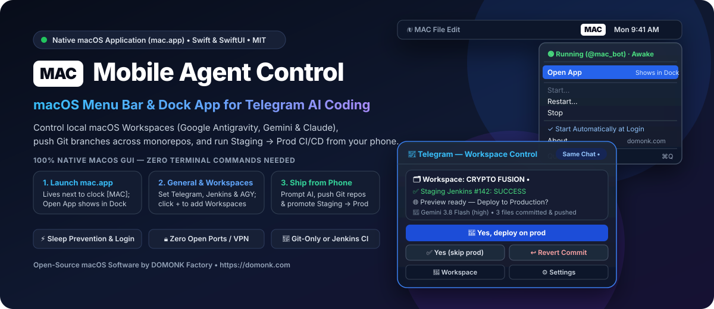
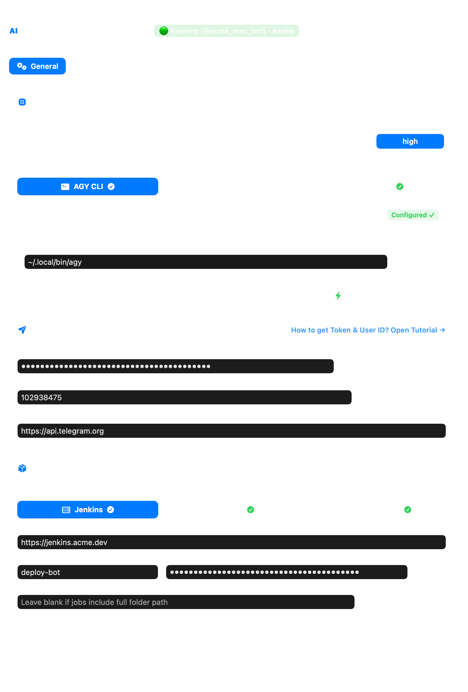
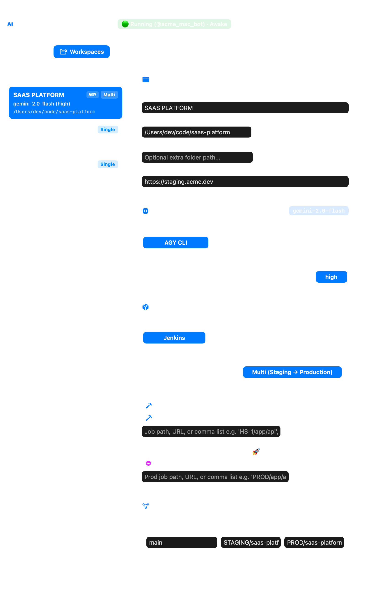
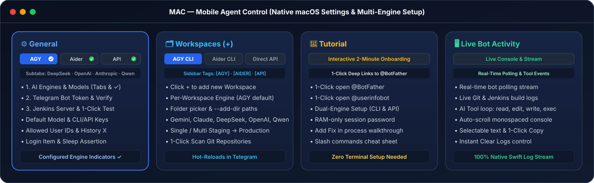

<div align="center">



# Mobile Agent Control (`mac.app` / `MAC`) — Native macOS App for Telegram AI Coding

**Free, open-source native Swift & SwiftUI macOS menu bar + Dock application (`mac.app`) to remotely control local AI coding Workspaces (Google Antigravity, Google Gemini & Anthropic Claude), push Git branches across single repos or monorepos, and run optional Staging → Production Jenkins CI/CD straight from Telegram.**

[](https://github.com/madmicrowave/mobile-agent-control/actions/workflows/ci.yml)
[](https://github.com/madmicrowave/mobile-agent-control/releases/latest)
[-000000?logo=apple&logoColor=white)](https://github.com/madmicrowave/mobile-agent-control)
[](https://swift.org)
[](./LICENSE)
[](https://domonk.com)

[**Download `mac.app`**](https://github.com/madmicrowave/mobile-agent-control/releases/latest) • [**App Screenshots**](#native-macos-application-preview) • [**2-Minute Setup**](#easy-2-minute-setup-100-gui--no-cli-needed) • [**Menu Bar & 4 Tabs**](#macos-menu-bar-controls--4-app-tabs) • [**Telegram Workflow**](#controlling-workspaces-via-telegram) • [**FAQ**](#frequently-asked-questions-faq)

</div>

---

## What is Mobile Agent Control (`mac.app`)?

**Mobile Agent Control (`mac.app`)** is a lightweight, 100% open-source **native macOS application** that places a bold **`MAC`** icon right next to your macOS menu bar clock (matching [Sticky-AI](https://github.com/madmicrowave/sticky-ai)'s `SAI` badge) and connects your local **Google Antigravity (`agy`)** coding Workspaces (**Google Gemini 3.8 Flash**, **Gemini 4 Argon**, **Claude Opus 5.5**, **Claude Sonnet 5.5**) directly to **Telegram** on your iPhone or Android.

Whether you are away from your desk, commuting, or testing a mobile build on your phone, you can:
1. **Switch between any local Mac Workspace** in one tap (`🔀 Workspace`) — each with its own AI model, effort level, active chat, and Git repositories.
2. **Continue your live Desktop chat** (`Same Chat •`) or start a **`🆕 New Chat`** — sending text prompts and up to **5 UI screenshots** at once.
3. **Use Git-Only Push Mode OR Full Jenkins CI/CD**:
   - **Git-Only Workspaces (No Jenkins Required)**: Leave Jenkins jobs empty and `mac.app` reviews modified files (`M` / `A` / `D`) across one or multiple Git repositories in the Workspace, then commits & pushes to your configured branch (or a new **Custom Branch**) right from Telegram.
   - **Single or Multi-Environment Jenkins CI/CD**: Attach **Single (Staging)** or **Multi (Staging → Production)** parameterized Jenkins jobs (`VERSION=<branch>`), stream build failure logs, verify your live preview URL, and tap **`🚀 Yes, deploy on prod`**, **`✅ Yes (skip prod deploy)`**, or **`↩️ Revert (Bad Commit)`**.

Zero terminal windows to keep open, zero `ngrok` / VPN / port forwarding, zero uploading private source code to third-party cloud sandboxes, and **automatic MacBook sleep prevention** whenever the bot is running.

---

## Native macOS Application Preview

`mac.app` is compiled natively with Apple `AppKit`, `SwiftUI`, `Combine`, and `IOKit` — zero Electron bloat and zero third-party npm dependencies.

<table>
  <tr>
    <td width="50%" align="center">
      
      <br />
      <sub><b>Tab 1: General</b> — Unified <b>Jenkins</b>, <b>Telegram</b> &amp; <b>AGY</b> setup, 1-click connection checks, Login Item toggle &amp; live sleep-prevention indicator.</sub>
    </td>
    <td width="50%" align="center">
      
      <br />
      <sub><b>Tab 2: Workspaces</b> — Click <b><code>+</code></b> to add Workspaces inline, scan single or multi-repo folders, pick AI models, and choose Git-only or Staging → Prod Jenkins.</sub>
    </td>
  </tr>
</table>



---

## Easy 2-Minute Setup (100% GUI — No CLI Needed)

### 1. Download or Build `mac.app`

- **Option A — Download Prebuilt macOS App (Fastest)**:
  Download **`mac-macOS.zip`** from [**GitHub Releases**](https://github.com/madmicrowave/mobile-agent-control/releases/latest), unzip it, drag **`mac.app`** into `/Applications`, and double-click **`mac.app`**.
- **Option B — Build from Source in One Command**:
  ```bash
  git clone https://github.com/madmicrowave/mobile-agent-control.git
  cd mobile-agent-control
  npm start
  ```
  `npm start` compiles **`mac.app`** natively with `swiftc` and launches the **`MAC`** icon next to your macOS clock.

### 2. Configure `General` & `Workspaces` Inside `mac.app`

1. **Click `MAC` Next to Your Clock → `Open App`** *(shows `mac.app` in your bottom Dock while open)*:
   - In the **`General`** tab (or **`Tutorial`** tab if you need a new bot), click **Open `@BotFather`**, send `/newbot`, paste your token into **General → Telegram**, and click **Verify Token**.
   - *(Optional)* Enter your numeric Telegram User ID (`@userinfobot`), **Jenkins** server URL/token (`Test Jenkins Connection`), and **AGY** CLI path / default AI model, then click **Save General Settings**.
2. **Open `Workspaces` Tab & Click `+`**:
   - Click **`+`** in the left sidebar — an empty Workspace draft appears on the left and opens the form on the right.
   - Enter a **Workspace Label** (e.g. `SAAS PLATFORM`, `MAC OS`), click **Browse...** to pick your project or monorepo folder, and click **Scan Git Repos**.
   - Pick the Workspace's **AI Model & Effort Level** (`low` / `medium` / `high`). Leave Jenkins jobs blank for **Git-only push**, or add **Single** / **Multi (Staging → Production)** Jenkins jobs, then click **Create Workspace**.
3. **Click `MAC` → `Start...`**:
   - Set a fresh **session password** for this run (kept strictly in RAM, never written to disk).
   - Open your Telegram bot, send `/start`, and reply once with the session password (auto-deleted from chat). You are ready to ship from anywhere!

---

## macOS Menu Bar Controls & 4 App Tabs

Clicking the **`MAC`** badge next to your macOS clock provides instant lifecycle control:

| Menu Bar Item | What It Does |
| :--- | :--- |
| **`Open App`** | Opens the 4-tab `mac.app` window (**General**, **Workspaces**, **Tutorial**, **Live Bot Activity**), brings it to the front, and displays **`mac.app` in the bottom macOS Dock**. Clicking **`✕`** closes the window cleanly back to the menu bar (removing the Dock icon) while keeping `MAC` running in the background. |
| **`Start...`** | Prompts for a fresh RAM-only session password, starts outbound Telegram long-polling, and **prevents your Mac from sleeping** (`IOKit` + `caffeinate`). |
| **`Restart...`** | Prompts for a new session password, restarts the bot process, and requires Telegram sessions to re-authenticate. |
| **`Stop`** | Stops the Telegram bot immediately and releases the macOS sleep assertion so your Mac sleeps normally again. |
| **`Start Automatically at Login`** | Manages `~/Library/LaunchAgents/com.domonk.mac.plist` so `MAC` starts automatically whenever you log in to macOS. |
| **`About`** | Opens the native **DOMONK Factory** About panel with a clickable link to [https://domonk.com](https://domonk.com). |

### Inside the 4 `mac.app` Window Tabs

1. **`⚙️ General`** — Combines **Jenkins** (server URL, credentials, timeout, 1-click connection test), **Telegram** (BotFather token, 1-click verify, allowed User IDs, history message count), and **AGY** (`agy` binary path, default AI model & effort level, Login Item toggle, sleep status).
2. **`🗂 Workspaces`** — Manage all Workspaces and click **`+`** to create new ones inline. Supports multi-repository folders (e.g. multiple Git repos under one parent Workspace), extra `--add-dir` paths, per-Workspace AI models, **Git-only push**, or **Single / Multi Staging → Production Jenkins**. Changes hot-reload into Telegram immediately.
3. **`📖 Tutorial`** — Interactive 2-minute onboarding guide with 1-click deep links to `@BotFather` and `@userinfobot`, Workspace & CI/CD walkthroughs, and Telegram command cheat sheets.
4. **`🖥 Live Bot Activity`** — Real-time, selectable, copyable monospaced log console streaming Telegram polling events, `agy` turns, Git pushes, and Jenkins builds.

---

## Controlling Workspaces via Telegram

```text
Click [MAC] Next to macOS Clock -> "Start..." -> Enter RAM-Only Session Password
   │  (MacBook sleep prevention automatically active while running)
   ▼
Open Bot in Telegram (/start) -> Send Session Password (auto-deleted from chat)
   │
   ▼
🗂 Select a Workspace (`•` marks active Workspace; `Same Chat •` active by default)
   ├── Type a prompt or attach up to 5 screenshots ──► Continues active Desktop chat immediately
   └── Tap "🆕 New Chat"                           ──► Starts a fresh Antigravity conversation
   │
   ▼
🤖 Antigravity (`agy`) runs locally on your Mac with the Workspace's AI Model & Level
   │
   ▼
📝 Formatted Agent Summary + Changed Files (`M` / `A` / `D` across single or multiple Git repos)
   Ask: Commit & push?
   ├── ❌ No (Discard Changes) ──► Cleans turn's uncommitted edits -> Ready
   ├── ✅ Yes                  ──► Commits & pushes modified repos on current/configured branch
   └── 🌿 Custom Branch        ──► Prompts for branch name -> `git checkout -B <branch>` -> commits & pushes
   │
   ├── (If Workspace has NO Jenkins jobs: Git push completes & Workspace unlocks -> Ready!)
   ▼
🚀 (If Jenkins configured) Ask: Run Jenkins / Run Staging Jenkins? (`buildWithParameters?VERSION=<branch>`)
   ├── ❌ Failed  ──► Streams Jenkins Console Error Log -> Retry / Revert / Keep
   └── ✅ Success ──► Ask: Is it okay?
                        ├── 🚀 Yes, deploy on prod (multi-env) ──► Runs Production Jenkins -> Ready
                        ├── ✅ Yes / Yes (skip prod deploy)    ──► Confirms & unlocks Workspace -> Ready
                        └── ↩️ Revert (Bad Commit)             ──► `git revert` + push + optional rollback deploy
```

### Telegram Buttons & Slash Commands

| Control / Command | Description |
| :--- | :--- |
| **`🔀 Workspace`** (`/workspaces`) | Switch between local Mac Workspaces; each Workspace keeps its own active chat and pending Git/Jenkins state. |
| **`⚙️ Settings`** (`/settings`, `/model`) | Change the **AI Model**, **Effort Level** (`low` / `medium` / `high`), or read **`📜 Last Messages`** for any Workspace. |
| **`🆕 New Chat`** (`/newchat`) | Start a fresh Antigravity conversation in the selected Workspace. |
| `/history` | Display the latest `X` user & agent messages from the active Workspace transcript. |
| `/lock` | Lock your Telegram session immediately until the session password is entered again. |

---

## Why Mobile Agent Control (`mac.app`)?

| Capability | Mobile Agent Control (`mac.app`) | SSH / Mobile Terminal | Cloud Agent Sandboxes |
| :--- | :--- | :--- | :--- |
| **macOS Experience** | ✅ Native SwiftUI menu bar (`MAC`) + Dock window | ❌ Manual SSH, `tmux` & `caffeinate` | ⚠️ Browser-only |
| **Network Security** | ✅ Outbound Telegram HTTPS polling (zero open ports) | ❌ Requires VPN / Tailscale / port forward | ⚠️ Source code leaves your Mac |
| **Real Local Workspaces** | ✅ Shares live Antigravity Desktop chats & local monorepos | ✅ Local shell | ❌ Isolated remote container |
| **Git-Only or Full CI/CD** | ✅ Multi-repo Git push out of the box + optional Staging → Prod Jenkins | ❌ Tiny phone keyboard for Git/CI | ⚠️ No local LAN Jenkins access |
| **Power Management** | ✅ Auto-starts at login & prevents Mac sleep while running | ❌ Mac sleeps mid-build | ✅ Cloud-hosted |

---

## System Requirements

- **macOS 14.0 (Sonoma) or later** (Apple Silicon `M1` / `M2` / `M3` / `M4` & Intel)
- **Node.js `>= 20.0.0`** (`brew install node` or [nodejs.org](https://nodejs.org))
- **Git** (`git --version`)
- **Google Antigravity CLI (`agy`)** installed locally (`~/.local/bin/agy` or on `PATH`)
- A free **Telegram Bot Token** from [`@BotFather`](https://t.me/BotFather)
- *(Optional)* **Jenkins** server with parameterized `VERSION` build jobs (not required for Git-only Workspaces)

---

## Frequently Asked Questions (FAQ)

<details>
<summary><b>Can I use <code>mac.app</code> with GitHub / GitLab repositories without Jenkins?</b></summary>
<br />
Yes! Jenkins is 100% optional. When a Workspace has no Jenkins jobs configured, <code>mac.app</code> runs your AI coding prompt, shows all modified files across one or multiple Git repositories in that folder, and lets you commit &amp; push directly to <code>main</code>/<code>master</code> or a custom branch (which can also trigger GitHub Actions or GitLab CI automatically).
</details>

<details>
<summary><b>Do I need ngrok, Cloudflare Tunnel, Tailscale, or router port forwarding?</b></summary>
<br />
No. <code>mac.app</code> uses outbound HTTPS long-polling (<code>getUpdates</code>) to <code>api.telegram.org</code>. Your Mac never opens an inbound port, and you can control your Workspaces from anywhere over 5G/LTE or Wi-Fi.
</details>

<details>
<summary><b>What happens when I click <code>Open App</code> vs closing the window with <code>✕</code>?</b></summary>
<br />
Clicking <b>Open App</b> in the <b>MAC</b> menu bar icon opens the 4-tab window and temporarily places <b>mac.app</b> in your bottom macOS Dock so you can switch to it easily while working. Clicking the red <b>✕</b> close button hides the window and removes the Dock icon while keeping <b>MAC</b> running next to your macOS clock.
</details>

<details>
<summary><b>Will my MacBook go to sleep while the bot is running?</b></summary>
<br />
No. Clicking <b>Start...</b> acquires a native macOS <code>PreventUserIdleSystemSleep</code> assertion (backed by <code>caffeinate</code>) so long AI turns and builds stay online. Clicking <b>Stop</b> or <b>Quit MAC</b> immediately restores normal sleep behavior.
</details>

<details>
<summary><b>Can someone add Workspaces or read tokens from Telegram?</b></summary>
<br />
Never. Workspace paths, Telegram tokens, and Jenkins API tokens stay strictly on your Mac in <code>data/config.json</code> (with <code>0600</code> owner-only permissions) and can only be viewed or edited locally inside <code>mac.app</code>. Every bot start also requires a fresh RAM-only session password.
</details>

---

## Development & Automated Tests

```bash
npm test            # Runs all Node.js unit/E2E tests + native macOS Swift app tests
npm run build:app   # Compiles standalone ./mac.app bundle
```

---

## More Open-Source macOS AI Applications by DOMONK Factory

- **[Sticky-AI (`Sticky-AI.app` / `SAI`)](https://github.com/madmicrowave/sticky-ai)** — Free, open-source native Swift macOS menu bar (`SAI`) & always-on-top floating **Google Gemini** desktop app toggled anywhere on macOS with **`Option + Space` (`⌥ + Space`)**.

If **Mobile Agent Control (`mac.app`)** speeds up your mobile coding & deployment workflow, please give the repository a **⭐️ Star on GitHub** — it helps other macOS developers discover the project!

---

## Open Source License & Credits

Released as free and open-source software under the **[MIT License](./LICENSE)**.

**Powered by [DOMONK Factory](https://domonk.com)** — [https://domonk.com](https://domonk.com)
