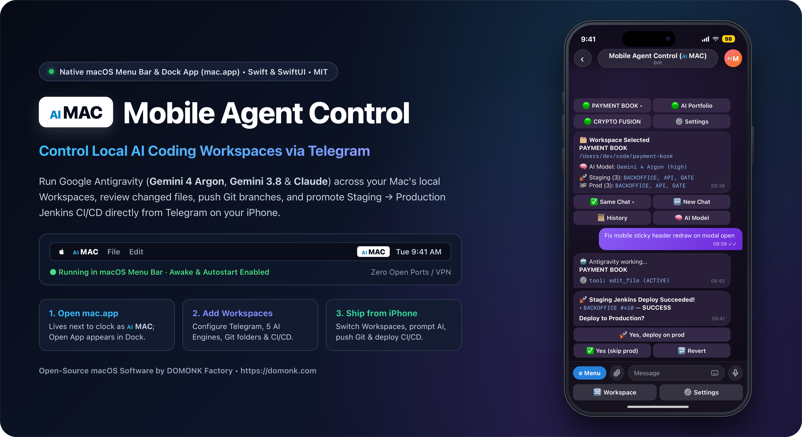

<div align="center">



# Mobile Agent Control (`mac.app` / `MAC`) — Native macOS App for Telegram AI Coding

**Free, open-source native Swift & SwiftUI macOS menu bar + Dock application (`mac.app`) to remotely control local AI coding Workspaces (Google Gemini, Anthropic Claude, DeepSeek, OpenAI, Qwen, and Personal Local Models via Terminal CLI or Direct API), push Git branches across single repos or monorepos, and run optional Staging → Production CI/CD (Jenkins, GitHub, Google Cloud Build) straight from Telegram.**

[](https://github.com/madmicrowave/mobile-agent-control/actions/workflows/ci.yml)
[](https://github.com/madmicrowave/mobile-agent-control/releases/latest)
[-000000?logo=apple&logoColor=white)](https://github.com/madmicrowave/mobile-agent-control)
[](https://swift.org)
[](./LICENSE)
[](https://domonk.com)

[**Download `mac.app`**](https://github.com/madmicrowave/mobile-agent-control/releases/latest) • [**App Screenshots**](#native-macos-application-preview) • [**AI Engines & Providers**](#supported-ai-models--dual-engine-architecture) • [**2-Minute Setup**](#easy-2-minute-setup-100-gui--no-cli-needed) • [**Menu Bar & 4 Tabs**](#macos-menu-bar-controls--4-app-tabs) • [**Telegram Workflow**](#controlling-workspaces-via-telegram) • [**FAQ**](#frequently-asked-questions-faq)

</div>

---

## What is Mobile Agent Control (`mac.app`)?

**Mobile Agent Control (`mac.app`)** is a lightweight, 100% open-source native macOS application that lets you control your local AI coding workspaces directly from **Telegram** on your iPhone or Android.

Send instructions or attach UI screenshots from your phone while away from your desk. The local AI agent executes prompts on your Mac inside your selected workspace/project, modifies files, runs tests, presents formatted summaries with git diffs, and automatically triggers deployment pipelines (Jenkins, GitHub, Google Cloud Build) to Staging and Production — perfect for doing real coding work, fixing bugs, and deploying changes on the go without sitting at your desk.

You can code, debug, review git diffs, commit, push, and deploy to Jenkins, GitHub, or Google Cloud Build from anywhere using your choice of frontier AI models:
- **Google Gemini**: Gemini 3.8 Flash, Gemini 4 Argon, Gemini 4 Carbon (low, medium, high effort levels)
- **Anthropic Claude**: Claude Opus 5.5, Claude Sonnet 5.5, Claude 3.7 Sonnet, Claude 3.5 Sonnet
- **DeepSeek**: DeepSeek V3 (`deepseek-chat`), DeepSeek R1 (`deepseek-reasoner`)
- **OpenAI**: GPT-4o, o3-mini, o1
- **Alibaba Qwen**: Qwen 2.5 Coder 32B, Qwen 2.5 72B
- **Personal Local AI Models (100% Offline & Private)**: Ollama (`llama3.3`, `qwen2.5-coder:32b`, `deepseek-r1:32b`, `mistral`, `codellama`), LM Studio, vLLM, LocalAI, Jan, or OpenRouter

Whether you are away from your desk, commuting, or testing a mobile build on your phone, you can:
1. **Switch between any local Mac Workspace** in one tap (`🔀 Workspace`) — each with its own AI model, effort level, active chat, and Git repositories.
2. **Continue your live Desktop chat** (`Same Chat •`) or start a **`🆕 New Chat`** — sending text prompts and up to **5 UI screenshots** at once.
3. **Iterate with "Add Fix" in the Same Process**: Review changed files (`M` / `A` / `D`), tap **`Add Fix`** to supply follow-up instructions without committing or resetting state, or tap **`✅ Yes`** to commit & push.
4. **Autonomous CI/CD & Error Recovery**:
   - **Git-Only Workspaces (No Jenkins Required)**: Commits & pushes to your configured branch or a new **Custom Branch** right from Telegram.
   - **Single or Multi-Environment CI/CD (Jenkins, GitHub, Google Cloud Build)**: Run Staging, inspect failure logs, tap **`↩️ Revert`** for an instant rollback deploy, or tap **`Fix Error`** to have AI automatically diagnose the build log, apply fixes, commit, and prompt to redeploy!

Zero terminal windows to keep open, zero `ngrok` / VPN / port forwarding, zero uploading private source code to third-party cloud sandboxes, and **automatic MacBook sleep prevention** whenever the bot is running.

---

## Supported AI Models & Dual-Engine Architecture

In `mac.app` **General → AI Engines & Models**, you can configure and run workflows using a modern tabbed layout where each tab displays a live **`✓` checkmark circle** on the right side when configured:

```text
┌─────────────────────────────────────────────────────────────────────────────┐
│                 Mobile Agent Control Multi-Engine Architecture              │
├──────────────────────────────────────┬──────────────────────────────────────┤
│  CLI Runner Tabs (Option 1)          │  Direct API Subtabs (Option 2)       │
│  [ AGY CLI (✓) ]   [ Aider CLI ]     │  [ Direct API (✓) ]                  │
├──────────────────────────────────────┼──────────────────────────────────────┤
│ • AGY CLI (Google Antigravity):      │ Subtabs with live configured status: │
│   Native support for Gemini 3.8/4,   │ • DeepSeek: V3 & R1                  │
│   Gemini 4 Carbon, Claude Opus 5.5   │ • OpenAI: GPT-4o, o3-mini, o1        │
│ • Aider CLI:                         │ • Anthropic: Claude 3.7 / 3.5 Sonnet │
│   Multi-model headless terminal agent│ • Qwen: Qwen 2.5 Coder 32B / 72B     │
│ • Custom binary path selector with   │ • Custom / Local: Ollama, LM Studio, │
│   1-click Browse... button           │   vLLM, LocalAI, Jan, OpenRouter     │
├──────────────────────────────────────┴──────────────────────────────────────┤
│  Per-Workspace AI Engine: Each Workspace independently selects its engine   │
│  (AGY CLI, Aider CLI, or Direct API) — defaulting to AGY for your projects! │
└─────────────────────────────────────────────────────────────────────────────┘
```

Both CLI tools and Direct API connect into the exact same Git inspection, diff review, Add Fix, and Telegram commit pipeline!

### Connect Personal Local AI Models (Ollama, LM Studio, vLLM, LocalAI, Jan)

Want to run your AI coding agent **100% privately, locally, and offline** without sending code, prompts, or git diffs to any external cloud provider or paying API fees?

Mobile Agent Control natively supports connecting to any local OpenAI-compatible inference server:

| Local Server | Default URL | Setup Command / Instructions |
| :--- | :--- | :--- |
| **Ollama** | `http://localhost:11434/v1` | `ollama run qwen2.5-coder:32b` or `ollama run llama3.3` (leave API key blank) |
| **LM Studio** | `http://localhost:1234/v1` | Start server on the *Local Server* tab (`localhost:1234`) |
| **vLLM** | `http://localhost:8000/v1` | `vllm serve <model_name> --port 8000` |
| **LocalAI / Jan** | `http://localhost:8080/v1` or `http://localhost:1337/v1` | Start local API server |
| **OpenRouter** | `https://openrouter.ai/api/v1` | Enter your OpenRouter API key |

#### Autonomous Tool-Calling Agent Loop
When you select **Direct API** with your personal local endpoint, `mac.app`'s built-in engine executes an **autonomous tool-calling loop** directly on your Mac:
- **`read_file`**: Reads target files and inspects surrounding code.
- **`list_dir`**: Explores directory trees and workspace structure.
- **`write_file`**: Creates new files or overwrites existing files.
- **`edit_file`**: Performs surgical search-and-replace patches.
- **`run_command`**: Runs local shell commands, builds, or automated test suites (e.g. `npm test`, `pytest`, `cargo test`).

The local model reasons, inspects files, applies changes, and returns a formatted summary to your phone. You review the git diff directly in Telegram, provide follow-up feedback via **➕ Add Fix**, or commit & push with **✅ Yes**!

---

## Native macOS Application Preview

`mac.app` is compiled natively with Apple `AppKit`, `SwiftUI`, `Combine`, and `IOKit` — zero Electron bloat and zero third-party npm dependencies.

<table>
  <tr>
    <td width="50%" align="center">
      
      <br />
      <sub><b>Tab 1: General</b> — Unified <b>1. AI Engines &amp; Models</b> (AGY CLI, Aider, Direct API), <b>2. Telegram</b> (token &amp; 1-click verify), <b>3. CI/CD Deployment</b> (Jenkins, GitHub, Google Cloud with 1-click tests), Login Item toggle &amp; live sleep-prevention indicator.</sub>
    </td>
    <td width="50%" align="center">
      
      <br />
      <sub><b>Tab 2: Workspaces</b> — Click <b><code>+</code></b> to add Workspaces inline, scan single or multi-repo folders, pick AI models (Gemini, Claude, DeepSeek, OpenAI, Qwen, Local), and choose Git-only checkbox or Staging → Prod CI/CD (Jenkins, GitHub, Google Cloud).</sub>
    </td>
  </tr>
</table>


---

## Easy 2-Minute Setup (100% GUI — No CLI Needed)

### 1. Download or Build `mac.app`

- **Option A — Download Prebuilt macOS App (Fastest)**:
  Download **`mac-macOS.zip`** from [**GitHub Releases**](https://github.com/madmicrowave/mobile-agent-control/releases/latest), unzip it, drag **`mac.app`** into `/Applications`, and double-click **`mac.app`**.
- **Option B — Build from Source in One Command**:
  ```bash
  git clone https://github.com/madmicrowave/mobile-agent-control.git
  cd mobile-agent-control
  npm start
  ```
  `npm start` compiles **`mac.app`** natively with `swiftc` and opens **Settings**.

### 2. Configure `General` & `Workspaces` Inside `mac.app`

1. **Click `MAC` in Menu Bar → `Settings`** *(shows `mac.app` in your bottom Dock while open)*:
   - In the **`General`** tab (organized into 3 clear cards):
     - **1. AI Engines & Models**:
       - *Default Model & Effort*: Choose your default model family (e.g. `Gemini 3.8 Flash`, `Claude 3.7 Sonnet`, `DeepSeek V3`, `Qwen 2.5 Coder`) and effort level (`low`, `medium`, `high`).
       - *AI Engine Tabs*: Click between **AGY CLI**, **Aider CLI**, and **Direct API** — each tab displays a green checkmark circle (`✓`) on the right when configured.
       - *CLI Runner Tabs*: Define your local executable path for `agy` or `aider` using the **Browse...** button.
       - *Direct API Subtabs*: Click between **DeepSeek**, **OpenAI**, **Anthropic**, **Qwen**, and **Custom / Local** to enter provider API keys or connect personal local models (e.g. `http://localhost:11434/v1` for Ollama, with zero API key needed).
     - **2. Telegram**: Click **Open `@BotFather`**, send `/newbot`, paste your token into **General → Telegram**, and click **Verify Token**. Lock down access by pasting allowed numeric Telegram User IDs (`@userinfobot`).
     - **3. CI/CD Deployment**: *(Optional)* Switch between **Jenkins**, **GitHub**, and **Google Cloud Build** tabs, enter credentials/tokens, and click 1-click test buttons (**Test Jenkins**, **Test Github**, **Test Google Cloud**). Click **Save**.
2. **Open `Workspaces` Tab & Click `+`**:
   - Click **`+`** in the left sidebar to create a new Workspace draft.
   - Enter a **Workspace Label** (e.g. `FRONTEND`, `BACKEND API`), click **Browse...** to pick your project folder, and click **Scan Git Repos**.
   - Select the Workspace's **AI Execution Engine** (**AGY CLI** [default], **Aider CLI**, or **Direct API**) and **AI Model & Effort Level** (e.g. `Gemini 4 Carbon (high)`, `DeepSeek V3`, `Claude 3.7 Sonnet`, `OpenAI GPT-4o`, `Qwen 2.5 Coder`, or Local models).
   - Choose your **CI/CD Provider** (**Git-only**, **Jenkins**, **GitHub**, or **Google Cloud**) and Environment Mode (**Single** or **Multi: Staging → Production**), then click **Save** (or **Create** for a new Workspace).
3. **Click `MAC` → `Start...`**:
   - Set a fresh **session password** for this run (kept strictly in RAM, never written to disk).
   - Open your Telegram bot, send `/start`, and reply once with the session password (auto-deleted from chat). You are ready to code remotely!

---

## macOS Menu Bar Controls & 4 App Tabs

Clicking the **`MAC`** menu bar icon provides instant lifecycle control:

| Menu Bar Item | What It Does |
| :--- | :--- |
| **`Settings`** | Opens the 4-tab `mac.app` window (**General**, **Workspaces**, **Tutorial**, **Live Bot Activity**), brings it to the front, and displays **`mac.app` in the bottom macOS Dock**. Clicking **`✕`** closes the window cleanly back to the menu bar (removing the Dock icon) while keeping `MAC` running in the background. |
| **`Start...`** | Prompts for a fresh RAM-only session password, starts outbound Telegram long-polling, and **prevents your Mac from sleeping** (`IOKit` + `caffeinate`). |
| **`Restart...`** | Prompts for a new session password, restarts the bot process, and requires Telegram sessions to re-authenticate. |
| **`Stop`** | Stops the Telegram bot immediately and releases the macOS sleep assertion so your Mac sleeps normally again. |
| **`Start Automatically at Login`** | Manages `~/Library/LaunchAgents/com.domonk.mac.plist` so `MAC` starts automatically whenever you log in to macOS. |
| **`About`** | Opens the native **DOMONK Factory** About panel with a clickable link to [https://domonk.com](https://domonk.com). |

### Inside the 4 `mac.app` Window Tabs

1. **`⚙️ General`** — Structured into 3 clear cards:
   - **1. AI Engines & Models**: Default Model Family & Effort Level, tabbed engine selection with live configured status (`[ AGY CLI (✓) ] [ Aider CLI ] [ Direct API (✓) ]`), binary file path pickers with **Browse...**, and Direct API subtabs (`DeepSeek`, `OpenAI`, `Anthropic`, `Qwen`, and `Custom / Local` for Ollama, LM Studio, vLLM, OpenRouter).
   - **2. Telegram**: Bot token, 1-click token verify, allowed numeric Telegram User IDs (`@userinfobot`), and message history count.
   - **3. CI/CD Deployment**: Sub-tabs for **Jenkins** (server URL, user, API token, timeout), **GitHub** (PAT token, default owner/org), and **Google Cloud Build** (Project ID, key JSON/token, region) with live connection test buttons and status indicators.
2. **`🗂 Workspaces`** — Manage all Workspaces and click **`+`** to create new ones inline. Supports selecting an independent **AI Execution Engine** (`AGY CLI`, `Aider CLI`, `Direct API`), multi-repository monorepos, extra `--add-dir` paths, per-Workspace AI models, and flexible **CI/CD Deployment** (**Git-only**, **Jenkins**, **GitHub**, or **Google Cloud**) across Single / Multi Staging → Production environments. Changes hot-reload into Telegram immediately.
3. **`📖 Tutorial`** — Interactive onboarding guide with 1-click deep links to `@BotFather` and `@userinfobot`, dual-engine CLI/API setup walkthrough, Workspace & CI/CD guides, and command cheat sheets.
4. **`🖥 Live Bot Activity`** — Real-time, selectable, copyable monospaced log console streaming Telegram polling events, AI agent turns, Git pushes, and CI/CD builds.

---

## Controlling Workspaces via Telegram

```text
Click [MAC] in Menu Bar -> "Start..." -> Enter RAM-Only Session Password
   │  (MacBook sleep prevention automatically active while running)
   ▼
Open Bot in Telegram (/start) -> Send Session Password (auto-deleted from chat)
   │
   ▼
🗂 Select a Workspace (`•` marks active Workspace; `Same Chat •` active by default)
   ├── Type a prompt or attach up to 5 screenshots ──► Continues active chat
   └── Tap "🆕 New Chat"                           ──► Starts a fresh conversation
   │
   ▼
🤖 AI Agent runs locally on your Mac (via CLI runner or Direct API)
   │
   ▼
📝 Formatted Agent Summary + Changed Files (`M` / `A` / `D` across single or multiple Git repos)
   Ask: Commit & push these changes?
   ├── ➕ Add Fix              ──► Prompts for follow-up fixes in same turn without resetting
   ├── ❌ No (Discard Changes) ──► Reverts uncommitted edits -> Ready
   ├── ✅ Yes                  ──► Commits & pushes modified repos on current/configured branch
   └── 🌿 Custom Branch        ──► Prompts for branch name -> `git checkout -B <branch>` -> commits & pushes
   │
   ├── (If Workspace has NO Jenkins jobs: Git push completes & Workspace unlocks -> Ready!)
   ▼
🚀 (If Jenkins configured) Ask: Run Jenkins / Run Staging Jenkins? (`buildWithParameters?VERSION=<branch>`)
   ├── ❌ Failed  ──► Streams Jenkins Console Error Log
   │                  ├── ↩️ Revert      ──► `git revert` + push + rollback Jenkins deploy
   │                  └── 🛠 Fix Error   ──► AI analyzes error log, auto-commits fix & prompts deploy
   └── ✅ Success ──► Ask: Deploy to Production?
                        ├── 🚀 Yes, deploy on prod (multi-env) ──► Runs Production Jenkins -> Ready
                        ├── ✅ Yes (skip prod)                 ──► Confirms & unlocks Workspace -> Ready
                        └── ↩️ Revert                          ──► Reverts bad commit
```

### Telegram Buttons & Slash Commands

| Control / Command | Description |
| :--- | :--- |
| **`🔀 Workspace`** (`/workspaces`) | Switch between local Mac Workspaces; each Workspace keeps its own active chat and pending Git/Jenkins state. |
| **`⚙️ Settings`** (`/settings`, `/model`) | Change the **AI Model** (Gemini, Claude, DeepSeek, OpenAI, Qwen), **Effort Level** (`low` / `medium` / `high`), or read **`📜 Last Messages`**. |
| **`🆕 New Chat`** (`/newchat`) | Start a fresh conversation in the selected Workspace. |
| **`➕ Add Fix`** | Provide follow-up instructions to refine changes within the current turn before committing. |
| **`🛠 Fix Error`** | Automatically diagnose a failed Jenkins build log with AI, apply fixes, commit, and prompt to redeploy. |
| **`↩️ Revert`** | Revert a bad commit and automatically trigger a rollback Jenkins deployment. |
| `/history` | Display the latest `X` user & agent messages from the active Workspace transcript. |
| `/lock` | Lock your Telegram session immediately until the session password is entered again. |

---

## Why Mobile Agent Control (`mac.app`)?

| Capability | Mobile Agent Control (`mac.app`) | SSH / Mobile Terminal | Cloud Agent Sandboxes |
| :--- | :--- | :--- | :--- |
| **Multi-Provider AI** | ✅ Gemini, Claude, DeepSeek, OpenAI, Qwen (CLI + Direct API) | ❌ Complex script setup | ⚠️ Vendor locked |
| **macOS Experience** | ✅ Native SwiftUI menu bar (`MAC`) + Dock window | ❌ Manual SSH, `tmux` & `caffeinate` | ⚠️ Browser-only |
| **Network Security** | ✅ Outbound Telegram HTTPS polling (zero open ports) | ❌ Requires VPN / Tailscale / port forward | ⚠️ Source code leaves your Mac |
| **Real Local Workspaces** | ✅ Shares live Desktop chats, local monorepos & files | ✅ Local shell | ❌ Isolated remote container |
| **Git & CI/CD Iteration**| ✅ "Add Fix", auto-revert & AI error recovery from phone | ❌ Clunky CLI typing | ⚠️ No local LAN Jenkins access |
| **Power Management** | ✅ Auto-starts at login & prevents Mac sleep while running | ❌ Mac sleeps mid-build | ✅ Cloud-hosted |

---

## System Requirements

- **macOS 14.0 (Sonoma) or later** (Apple Silicon `M1` / `M2` / `M3` / `M4` & Intel)
- **Node.js `>= 20.0.0`** (`brew install node` or [nodejs.org](https://nodejs.org))
- **Git** (`git --version`)
- A free **Telegram Bot Token** from [`@BotFather`](https://t.me/BotFather)
- Either:
  - **Option 1**: Local CLI binary (`agy` or `aider`), **OR**
  - **Option 2**: API key for cloud models (DeepSeek, OpenAI, Anthropic Claude, Qwen) or a personal local AI model runner (Ollama, LM Studio, vLLM, LocalAI) with zero API keys required
- *(Optional)* **Jenkins** server with parameterized `VERSION` build jobs (not required for Git-only Workspaces)

---

## Frequently Asked Questions (FAQ)

<details>
<summary><b>Can I connect and use my own personal local AI models (Ollama, LM Studio, vLLM)?</b></summary>
<br />
Yes! In <b>General → AI Engines &amp; Models → Direct API</b>, select the <b>Custom / Local</b> subtab and enter your local endpoint (e.g. <code>http://localhost:11434/v1</code> for Ollama or <code>http://localhost:1234/v1</code> for LM Studio). Leave the API key blank. The runner executes an autonomous tool-calling agent loop (<code>read_file</code>, <code>write_file</code>, <code>edit_file</code>, <code>list_dir</code>, <code>run_command</code>) 100% locally on your Mac with zero code, prompts, or diffs sent to any cloud provider.
</details>

<details>
<summary><b>How does the autonomous agent tool loop work with local models or Direct API?</b></summary>
<br />
When executing with Direct API (including personal local models), <code>mac.app</code> provides an OpenAI-compatible function-calling loop. The model can inspect directories, read specific files, apply diff-based edits, and run shell commands (like unit tests or builds). Once the model signals completion, <code>mac.app</code> gathers all git diffs across your repository, formats a clean summary, and presents changed files (<code>M</code> / <code>A</code> / <code>D</code>) to your phone via Telegram.
</details>

<details>
<summary><b>Can I use DeepSeek, OpenAI, or Claude without installing terminal tools?</b></summary>
<br />
Yes! With <b>Option 2: Direct API</b>, you just paste your API key (DeepSeek, OpenAI, Anthropic, or Qwen) into the <b>General</b> tab of <code>mac.app</code>. The app runs a native tool-calling agent that reads files, applies edits, and runs commands directly in your workspace without needing any external CLI tools installed.
</details>

<details>
<summary><b>How does the "Add Fix" button work?</b></summary>
<br />
When the agent finishes an edit, Telegram presents the summary and asks <i>"Commit &amp; push these changes?"</i>. If you notice something missing or want to adjust the code before committing, tap <b>➕ Add Fix</b> and send your feedback. The agent receives your message in the same process, updates the code, and presents the new diff without losing state or creating extra commits.
</details>

<details>
<summary><b>Can I use <code>mac.app</code> with GitHub / GitLab repositories without Jenkins?</b></summary>
<br />
Yes! Jenkins is 100% optional. When a Workspace has no Jenkins jobs configured, <code>mac.app</code> runs your AI coding prompt, shows all modified files across one or multiple Git repositories in that folder, and lets you commit &amp; push directly to <code>main</code>/<code>master</code> or a custom branch.
</details>

<details>
<summary><b>For GitHub CI/CD, do I need to define jobs or how does it work?</b></summary>
<br />
You do <b>not</b> need to configure individual jobs! Unlike Jenkins (where each build job is an explicit URL/path on your server), GitHub organizes builds into <b>Workflow Files</b> (e.g. <code>deploy.yml</code>, <code>ci.yml</code>, or <code>deploy-prod.yml</code>) defined inside your repository under <code>.github/workflows/</code>. In <code>mac.app</code>, you simply enter the workflow filename. When you trigger deployment from Telegram, <code>mac.app</code> invokes the GitHub REST API (<code>/actions/workflows/{workflow}/dispatches</code>), and GitHub automatically runs whichever jobs, steps, and matrices are defined inside that workflow YAML. <code>mac.app</code> then tracks the run and streams the real-time status and logs back to Telegram.
</details>

<details>
<summary><b>Do I need ngrok, Cloudflare Tunnel, Tailscale, or router port forwarding?</b></summary>
<br />
No. <code>mac.app</code> uses outbound HTTPS long-polling (<code>getUpdates</code>) to <code>api.telegram.org</code>. Your Mac never opens an inbound port, and you can control your Workspaces from anywhere over 5G/LTE or Wi-Fi.
</details>

<details>
<summary><b>What happens when I click <code>Settings</code> vs closing the window with <code>✕</code>?</b></summary>
<br />
Clicking <b>Settings</b> in the <b>MAC</b> menu bar icon opens the 4-tab window and temporarily places <b>mac.app</b> in your bottom macOS Dock so you can switch to it easily while working. Clicking the red <b>✕</b> close button hides the window and removes the Dock icon while keeping <b>MAC</b> running in the menu bar.
</details>

<details>
<summary><b>Will my MacBook go to sleep while the bot is running?</b></summary>
<br />
No. Clicking <b>Start...</b> acquires a native macOS <code>PreventUserIdleSystemSleep</code> assertion (backed by <code>caffeinate</code>) so long AI turns and builds stay online. Clicking <b>Stop</b> or <b>Quit MAC</b> immediately restores normal sleep behavior.
</details>

<details>
<summary><b>Are my API keys and tokens stored securely?</b></summary>
<br />
Yes. All configuration stays strictly on your local Mac in <code>data/config.json</code> with <code>0600</code> owner-only POSIX permissions. Tokens and API keys are never sent to external servers other than the respective official API endpoints (Telegram, Anthropic, OpenAI, DeepSeek, Jenkins, GitHub, Google Cloud). Furthermore, session access requires a fresh RAM-only password set on every launch.
</details>

---

## Terminal CLI & Configuration Commands

In addition to the 100% native GUI in `mac.app`, you can configure and test all integrations directly from your terminal:

```bash
# Full interactive setup wizard (walks through Telegram, Jenkins, GitHub, Google Cloud, AI Engines, and Workspaces)
npm run setup

# Workspace & CI/CD management
npm run add-workspace             # Register / scan an available Workspace folder or edit existing
npm run jenkins-add-user          # Configure Jenkins URL, user & API token
npm run jenkins-test-access       # Test Jenkins connection
npm run github-add-user           # Configure GitHub Personal Access Token & default owner
npm run github-test-access        # Test GitHub REST API connection & verify scopes
npm run google-cloud-add-user     # Configure Google Cloud Build Project ID & key
npm run google-cloud-test-access  # Test Google Cloud Build access
npm run ai-engines                # Configure local CLI binaries (agy, aider) & Direct API keys
```

---

## Development & Automated Tests

```bash
npm test            # Runs all Node.js unit/E2E tests + native macOS Swift app tests
npm run build:app   # Compiles standalone ./mac.app bundle
```

---

## More Open-Source macOS AI Applications by DOMONK Factory

- **[Sticky-AI (`sticky-ai.app` / `SAI`)](https://github.com/madmicrowave/sticky-ai)** — Free, open-source native Swift macOS menu bar (`SAI`) & always-on-top floating **Google Gemini** desktop app toggled anywhere on macOS with **`Option + Space` (`⌥ + Space`)**.

If **Mobile Agent Control (`mac.app`)** speeds up your mobile coding & deployment workflow, please give the repository a **⭐️ Star on GitHub** — it helps other macOS developers discover the project!

---

## Open Source License & Credits

Released as free and open-source software under the **[MIT License](./LICENSE)**.

**Powered by [DOMONK Factory](https://domonk.com)** — [https://domonk.com](https://domonk.com)
